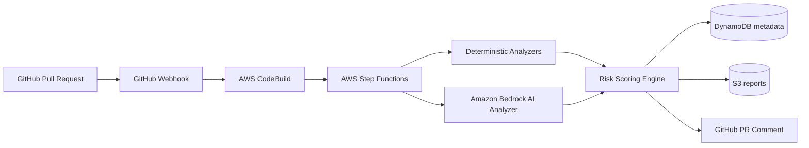
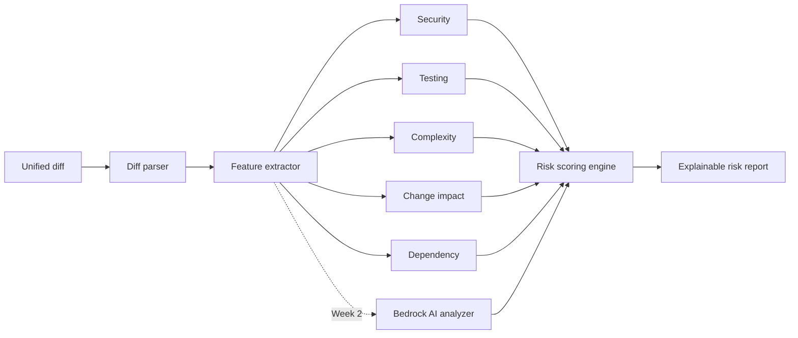

# AI-SDLC Guardian

**AI-powered risk and quality analysis for GitHub pull requests.**

Guardian analyzes every pull request before merge and produces an explainable
**0–100 Risk Score** with actionable recommendations, by combining
deterministic static analysis with generative AI review through Amazon
Bedrock.

> **Status: Week 1 (v0.1)** — the local analysis engine is complete: diff
> parsing, five deterministic analyzers, the explainable scoring engine, and a
> CLI. Bedrock AI analysis, the AWS workflow, GitHub automation, the benchmark
> and the dashboard land in Weeks 2–4 (see [Roadmap](#roadmap)).

## 1. Problem

Code review is the last line of defense before defects, vulnerabilities, and
breaking changes reach production — and it is chronically overloaded.
Reviewers rarely have time to ask, for every PR: does this touch
authentication? does it change a database schema? did tests come with it? is
this SQL built by string concatenation? High-risk changes get the same
attention as typo fixes.

## 2. Motivation

Static analyzers are precise but shallow; LLM reviewers are contextual but
unreliable when unconstrained. Guardian's hypothesis — and its research
question — is that a **hybrid** works better than either alone: deterministic
rules provide grounded, reproducible signals; the LLM adds contextual
reasoning over the diff; and a transparent scoring engine (never the LLM)
turns both into one explainable score.

## 3. Architecture



The analysis pipeline itself is plain Python and runs identically on a laptop
(CLI), in CI, or inside Lambda:



Details: [docs/architecture.md](docs/architecture.md).

## 4. Features

- **Unified diff parsing** — file changes, per-line attribution (adds with
  new-file line numbers, removals with old-file line numbers), renames,
  deletions, binary files.
- **Deterministic analyzers** — security (SQL injection patterns, hardcoded
  secrets, disabled TLS verification, unsafe deserialization, weakened JWT
  verification, …), testing gaps, complexity/churn, change impact (auth,
  payment, schema, API surface, CI, infra), dependency changes.
- **Explainable scoring** — a confidence-weighted, severity-based 0–100 score
  per dimension, combined with configurable weights. Every score traces back
  to concrete findings; the report says *why*.
- **CI gate** — `guardian analyze --fail-on HIGH` exits non-zero at or above
  the chosen risk level.
- **Structured output** — Markdown for humans/PR comments, JSON for machines.

## 5. Installation

```bash
git clone https://github.com/your-org/ai-sdlc-guardian.git
cd ai-sdlc-guardian/backend
python3 -m venv .venv && source .venv/bin/activate
pip install -e ".[dev]"
pytest            # 70 tests, ~98% coverage of the engine
```

Analyze a PR diff locally:

```bash
git diff main...feature-branch > pr.diff
guardian analyze --diff pr.diff --repo acme/shop --pr 42
```

Try the bundled example:

```bash
guardian analyze --diff examples/risky-payment-pr.diff --meta examples/risky-payment-pr.json
```

## 6. AWS deployment

Week 1 ships the CDK foundation (DynamoDB metadata table + encrypted S3
report bucket). The full serverless workflow arrives in Week 2.

```bash
cd infrastructure
npm install
npm run build       # typecheck
npx cdk deploy      # requires AWS credentials + CDK bootstrap
```

## 7. GitHub integration

Automatic webhook-driven analysis with an auto-updating PR comment is a
Week 3 deliverable. Today you can wire the CLI into any CI system:

```yaml
- run: |
    git diff origin/${{ github.base_ref }}...HEAD > pr.diff
    guardian analyze --diff pr.diff --repo ${{ github.repository }} \
      --pr ${{ github.event.number }} --fail-on HIGH
```

## 8. Example report

See [examples/example-report.md](examples/example-report.md) — real output of
`guardian analyze` on [examples/risky-payment-pr.diff](examples/risky-payment-pr.diff),
a PR that introduces SQL string interpolation, a hardcoded key, disabled TLS
verification, and an untested authentication change. Excerpt:

> **Overall Risk: 62/100 — 🟠 HIGH** · Merge recommendation: **REVIEW REQUIRED**

## 9. Risk methodology

- Analyzers emit structured findings: `category`, `severity`, `confidence`,
  `file`, `line`, `rule`, `reason`, `recommendation`, `evidence`.
- Each scoring dimension is the capped, confidence-weighted sum of severity
  points (LOW 6, MEDIUM 14, HIGH 28, CRITICAL 45).
- Overall = weighted average — Security 30%, Testing 25%, Change Impact 20%,
  Complexity 15%, AI 10% (configurable; absent signal sources are
  renormalized away).
- 0–30 **LOW** · 31–60 **MEDIUM** · 61–80 **HIGH** · 81–100 **CRITICAL**.
- **The LLM never sets the score.** AI findings are one input dimension,
  scored by the same deterministic engine.

Full write-up: [docs/risk-scoring.md](docs/risk-scoring.md).

## 10. Benchmark methodology

A core deliverable (Week 4): 100–300 labeled PRs across security, bug,
auth, database, API, testing-gap, and low-risk categories; comparing
(A) static-only, (B) LLM-only, (C) hybrid on precision, recall, F1,
false-positive/negative rate, latency, and cost.

**No benchmark data has been collected yet — all results are pending.**
Nothing in this repository reports fabricated numbers.

## 11. Security & privacy

- Repository code is **untrusted input**: it is parsed, never executed, and
  instructions embedded in code or comments are never treated as system
  instructions (prompt-injection defense for the Week 2 AI analyzer).
- No secrets in source; AWS credentials via IAM, GitHub tokens via Secrets
  Manager (Week 3).
- DynamoDB stores metadata only; S3 stores sanitized reports; raw repository
  source is not persisted. Report artifacts expire after 90 days by default.
- See [SECURITY.md](SECURITY.md) for the vulnerability disclosure policy.

## 12. Roadmap

| Week | Deliverable | Status |
|---|---|---|
| 1 | Local engine: parser, deterministic analyzers, scoring, CLI, tests, CDK foundation | ✅ done |
| 2 | Bedrock AI analyzer, Step Functions workflow, Lambda, DynamoDB/S3 persistence, CloudWatch | ⏳ |
| 3 | GitHub webhook + auto-updating PR comments, Secrets Manager, retries, monitoring | ⏳ |
| 4 | Benchmark framework + dataset, React dashboard, docs, v1.0 | ⏳ |

## 13. Contributing

See [CONTRIBUTING.md](CONTRIBUTING.md). Small, tested PRs welcome — new
analyzer rules are a great first contribution.

## 14. Research

Guardian is designed to support a reproducible study, tentatively titled
*"AI-SDLC Guardian: A Hybrid AI Framework for Automated Risk Assessment in
Modern Software Development."* Research question: can deterministic analysis
plus LLM contextual reasoning identify PR risk better than either approach
alone? Experiment configurations and raw results will be preserved under
`benchmark/` for reproducibility.

## 15. License

[MIT](LICENSE).
