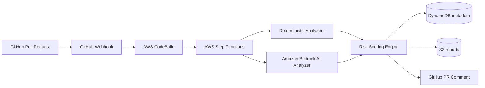
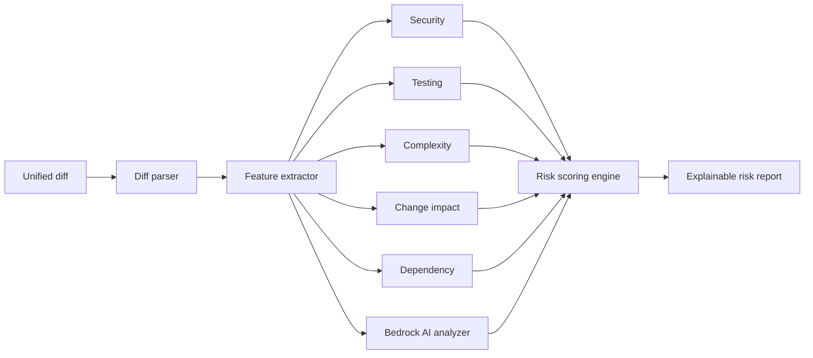

# AI-SDLC Guardian

**AI-powered risk and quality analysis for GitHub pull requests.**

Guardian analyzes every pull request before merge and produces an explainable
**0–100 Risk Score** with actionable recommendations, by combining
deterministic static analysis with generative AI review through Amazon
Bedrock.

> **Status: v0.3 — the automated pipeline is complete.** Open a PR on a
> connected repo and the risk report appears on it automatically; local/CI
> analysis works via the CLI. The evaluation benchmark and the dashboard
> (Week 4) are still ahead. Full detail:
> [§12 Project status & roadmap](#12-project-status--roadmap).

## 1. Problem

Code review is the last line of defense before defects, vulnerabilities, and
breaking changes reach production — and it is chronically overloaded.
Reviewers rarely have time to ask, for every PR: does this touch
authentication? does it change a database schema? did tests come with it? is
this SQL built by string concatenation? High-risk changes get the same
attention as typo fixes.

## 2. Motivation

Static analyzers are precise but shallow; LLM reviewers are contextual but
unreliable when unconstrained. Guardian's hypothesis — and its research
question — is that a **hybrid** works better than either alone: deterministic
rules provide grounded, reproducible signals; the LLM adds contextual
reasoning over the diff; and a transparent scoring engine (never the LLM)
turns both into one explainable score.

## 3. Architecture



The analysis pipeline itself is plain Python and runs identically on a laptop
(CLI), in CI, or inside Lambda:



Details: [docs/architecture.md](docs/architecture.md).

## 4. Features

- **Unified diff parsing** — file changes, per-line attribution (adds with
  new-file line numbers, removals with old-file line numbers), renames,
  deletions, binary files.
- **Deterministic analyzers** — security (SQL injection patterns, hardcoded
  secrets, disabled TLS verification, unsafe deserialization, weakened JWT
  verification, …), testing gaps, complexity/churn, change impact (auth,
  payment, schema, API surface, CI, infra), dependency changes.
- **Explainable scoring** — a confidence-weighted, severity-based 0–100 score
  per dimension, combined with configurable weights. Every score traces back
  to concrete findings; the report says *why*.
- **AI review via Amazon Bedrock** — the diff plus deterministic findings go
  to a configurable Claude model (Converse API) acting as a senior reviewer.
  Every AI finding must quote evidence that Guardian verifies against the
  actual diff — ungrounded findings are discarded by the parser, not merely
  discouraged by the prompt. The model never sets the score.
- **Prompt-injection hardened** — the diff travels inside explicit untrusted
  markers; instructions embedded in code or comments are treated as a
  security finding, never followed.
- **Serverless workflow** — Step Functions orchestrates analyze/store Lambdas
  (ARM64) with retries, timeouts, and failure isolation; metadata lands in
  DynamoDB, full reports in S3; low-cardinality CloudWatch metrics and a
  workflow-failure alarm.
- **Cost controls** — optional escalation gate (skip the model on clearly
  low-risk PRs, off by default), prompt caching, per-analysis cost estimates
  in reports and metrics.
- **CI gate** — `guardian analyze --fail-on HIGH` exits non-zero at or above
  the chosen risk level.
- **Structured output** — Markdown for humans/PR comments, JSON for machines.

## 5. Installation

Requires **Python 3.11+** (3.12 is what CI runs).

```bash
git clone https://github.com/your-org/ai-sdlc-guardian.git
cd ai-sdlc-guardian/backend
python3.11 -m venv .venv && source .venv/bin/activate
pip install --upgrade pip          # editable install needs pip >= 21.3
pip install -e ".[dev]"
pytest            # 180 tests; all AWS/GitHub/Bedrock calls mocked
```

Analyze a PR diff locally:

```bash
git diff main...feature-branch > pr.diff
guardian analyze --diff pr.diff --repo acme/shop --pr 42
```

Try the bundled example:

```bash
guardian analyze --diff examples/risky-payment-pr.diff --meta examples/risky-payment-pr.json
```

## 6. AWS deployment

The CDK app deploys the full Week 2 workflow: Step Functions, analyze/store
Lambdas, DynamoDB, S3, CloudWatch metrics and alarm.

```bash
cd infrastructure
npm install
npm run build       # typecheck
npx cdk synth       # works without Docker (host pip cross-bundles the Lambda)
npx cdk deploy      # requires AWS credentials + CDK bootstrap
```

Prerequisite: enable the configured Claude model in the Bedrock console for
your region (default `anthropic.claude-sonnet-5`, overridable via the
`bedrockModelId` stack prop or `GUARDIAN_BEDROCK_MODEL_ID`).

Run an analysis through AWS by starting an execution:

```bash
aws stepfunctions start-execution --state-machine-arn <StateMachineArn> \
  --input '{"repository":"acme/shop","pr_number":42,"diff":"'"$(git diff main...HEAD | sed 's/"/\\"/g')"'"}'
```

(or upload the diff to `artifacts/` in the reports bucket and pass
`diff_s3_key` instead — required for large diffs).

## 7. GitHub integration

Webhook-driven analysis is built in. After `cdk deploy`:

1. **Put a GitHub token in the secret** (the `GitHubSecretArn` output):
   replace the `token` field's `REPLACE_ME` with a fine-grained PAT that has
   *Pull requests: read/write* and *Contents: read* on the target repos.
   Never commit tokens.
2. **Add the webhook** in the repo/org settings: Payload URL = the
   `WebhookUrl` stack output, content type `application/json`, secret = the
   `webhook_secret` value from the same AWS secret, events = *Pull requests*.
3. Open, reopen, or push to a PR. Guardian fetches the diff, runs the full
   analysis, and posts the risk report as a PR comment — **updating the same
   comment in place** on later pushes (marker-based, no comment spam).

Security properties of the webhook path: constant-time HMAC-SHA256 signature
verification before any parsing (the Function URL has no other auth by
design); delivery-id de-duplication in DynamoDB (TTL'd) so GitHub redeliveries
don't double-analyze; payload fields used only as identifiers; logs carry
repo/PR/delivery ids, never payload bodies.

No AWS at all? The CLI gate works in any CI system today:

```yaml
- run: |
    git diff origin/${{ github.base_ref }}...HEAD > pr.diff
    guardian analyze --diff pr.diff --repo ${{ github.repository }} \
      --pr ${{ github.event.number }} --fail-on HIGH
```

## 8. Example report

See [examples/example-report.md](examples/example-report.md) — real output of
`guardian analyze` on [examples/risky-payment-pr.diff](examples/risky-payment-pr.diff),
a PR that introduces SQL string interpolation, a hardcoded key, disabled TLS
verification, and an untested authentication change. Excerpt:

> **Overall Risk: 62/100 — 🟠 HIGH** · Merge recommendation: **REVIEW REQUIRED**

## 9. Risk methodology

- Analyzers emit structured findings: `category`, `severity`, `confidence`,
  `file`, `line`, `rule`, `reason`, `recommendation`, `evidence`.
- Each scoring dimension is the capped, confidence-weighted sum of severity
  points (LOW 6, MEDIUM 14, HIGH 28, CRITICAL 45).
- Overall = weighted average — Security 30%, Testing 25%, Change Impact 20%,
  Complexity 15%, AI 10% (configurable; absent signal sources are
  renormalized away).
- 0–30 **LOW** · 31–60 **MEDIUM** · 61–80 **HIGH** · 81–100 **CRITICAL**.
- **The LLM never sets the score.** AI findings are one input dimension,
  scored by the same deterministic engine.

Full write-up: [docs/risk-scoring.md](docs/risk-scoring.md).

## 10. Benchmark methodology

A core deliverable (Week 4): 100–300 labeled PRs across security, bug,
auth, database, API, testing-gap, and low-risk categories; comparing
(A) static-only, (B) LLM-only, (C) hybrid on precision, recall, F1,
false-positive/negative rate, latency, and cost.

**No benchmark data has been collected yet — all results are pending.**
Nothing in this repository reports fabricated numbers.

## 11. Security & privacy

- Repository code is **untrusted input**: it is parsed, never executed, and
  instructions embedded in code or comments are never treated as system
  instructions (prompt-injection defense for the Week 2 AI analyzer).
- No secrets in source; AWS credentials via IAM, GitHub tokens via Secrets
  Manager (Week 3).
- DynamoDB stores metadata only; S3 stores sanitized reports; raw repository
  source is not persisted. Report artifacts expire after 90 days by default.
- See [SECURITY.md](SECURITY.md) for the vulnerability disclosure policy.

## 12. Project status & roadmap

### Where the project stands (v0.2)

**Works today**

- Full local/CI analysis via the `guardian` CLI: diff parsing, 28
  deterministic rules across 5 analyzers, explainable 0–100 scoring,
  Markdown/JSON reports, `--fail-on` merge gate.
- Full AWS-hosted analysis: Step Functions workflow (fetch → analyze → store
  → comment) with Bedrock AI review (evidence-grounded, prompt-injection
  hardened), DynamoDB metadata, S3 reports, CloudWatch metrics and alarms.
  Deployable with `cdk deploy`; synth verified without Docker.
- End-to-end GitHub automation: signed webhook → analysis → auto-updating PR
  comment, with Secrets Manager for credentials and delivery de-duplication.
- Cost controls: prompt caching, per-analysis cost estimates, and an
  optional deterministic escalation gate (off by default).
- 127 tests, ~97% coverage; CI enforces an 80% floor. All AWS, GitHub, and
  model calls are mocked or stub-driven — no test touches the network.

**In progress**

- Benchmark: dataset pipeline, a **105-record** confirmed dataset across all
  seven categories, the four-arm evaluation runner, and a React dashboard all
  exist. The deterministic baseline is measured (arm A: recall ~0.06, FPR
  0.00 on the calibration split — precise but blind). The three model-invoking
  arms (LLM-only / hybrid / gated) are **blocked on a one-time Bedrock
  use-case form** for the deployment account — the runner works, the account
  gate does not; see `benchmark/README.md`. Nothing here reports fabricated
  numbers, and no partial model-arm results are published.

### Delivery plan

| Phase | Deliverable | Status |
|---|---|---|
| Week 1 | Local engine: parser, 5 deterministic analyzers, scoring engine, CLI, CDK foundation | ✅ v0.1 |
| Week 2 | Bedrock AI analyzer (evidence-grounded), Step Functions + Lambda, DynamoDB/S3, CloudWatch | ✅ v0.2 |
| Week 3 | GitHub automation: signed webhook, auto-updating PR comments, Secrets Manager, dedup | ✅ v0.3 |
| Week 4 | Benchmark pipeline + runner, 105-record dataset, dashboard; arm-A baseline | ✅ v0.4 |
| — | Model arms B/C/D (blocked on Bedrock use-case form), grow dataset, v1.0 tag | ⏳ |

**Remaining before v1.0**

- Submit the Bedrock use-case form, then run arms B/C/D on calibration and,
  once, the holdout — completing the hybrid comparison.
- Grow the dataset toward ~200 (more mining + confirmation).
- Tag v1.0.0 with release notes.

**Original Week 4 plan (for reference)**

- Benchmark framework over 100–300 labeled PRs in 7 categories; arms:
  (A) deterministic-only, (B) LLM-only, (C) hybrid, (D) gated hybrid.
  Precision/recall/F1, FP/FN rate, latency, cost; JSON + CSV export;
  every number regenerable from committed configs.
- React dashboard (totals, risk distribution and trends, recent analyses).
- Batch inference for offline evaluation runs (50% token discount).
- v1.0: reproducible release + research write-up groundwork.

### Beyond v1.0 (direction, not commitments)

- **Zero-infrastructure tier** — run entirely inside GitHub Actions with the
  adopter's API key; the CLI gate already supports this today.
- **More model providers** behind the existing `LLMProvider` interface
  (Claude Platform on AWS for batch/caching parity; Ollama for offline and
  no-cloud benchmarking).
- **Tiered model routing** — small model first, escalate to a stronger model
  on signal; measured as its own benchmark arm before becoming a default.
- **Deeper deterministic analysis** — AST-based rules where regexes plateau,
  language-aware API-contract checks.
- **GitLab/Bitbucket adapters** once the GitHub path is stable.

## 13. Contributing

See [CONTRIBUTING.md](CONTRIBUTING.md). Small, tested PRs welcome — new
analyzer rules are a great first contribution.

## 14. Research

Guardian is designed to support a reproducible study, tentatively titled
*"AI-SDLC Guardian: A Hybrid AI Framework for Automated Risk Assessment in
Modern Software Development."* Research question: can deterministic analysis
plus LLM contextual reasoning identify PR risk better than either approach
alone? Experiment configurations and raw results will be preserved under
`benchmark/` for reproducibility.

## 15. License

[MIT](LICENSE).
