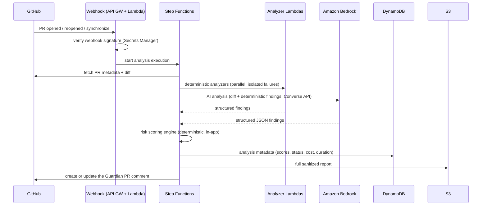

# Architecture

## Target system (end state, Week 3+)



## Layering

| Layer | Package | Responsibility |
|---|---|---|
| Models | `guardian.models` | Pydantic schemas shared by everything: `PRContext`, `Finding`, `RiskReport`, config |
| Ingestion | `guardian.github` | Unified diff parser, PR loaders (local files now; GitHub API in Week 3) |
| Analysis | `guardian.analyzers` | `BaseAnalyzer` contract + five deterministic analyzers; the Bedrock analyzer (Week 2) implements the same contract |
| Scoring | `guardian.scoring` | Explainable 0–100 engine; the only place a score is computed |
| Orchestration | `guardian.services` | Feature extraction, analyzer isolation, report assembly |
| Presentation | `guardian.reporting`, `guardian.cli` | Markdown/JSON rendering, CLI + CI gate |
| AWS | `guardian.handlers`, `infrastructure/` | Lambda entry points (Week 2), CDK stacks |

Design invariants:

1. **One pipeline everywhere.** The CLI, CI, and Lambda all call
   `AnalysisService.analyze(PRContext) -> RiskReport`. AWS wrapping is thin.
2. **Findings are the only currency.** Every analyzer — deterministic or AI —
   returns `Finding` objects; the scoring engine consumes only findings.
   Adding an analyzer never touches scoring.
3. **The LLM never scores.** AI output is findings evidence, mapped into one
   weighted dimension by the deterministic engine.
4. **Repository code is untrusted data.** It is parsed with regexes, never
   executed or eval'd, and never interpreted as instructions.
5. **Failure isolation.** A crashing analyzer is recorded in
   `analyzer_failures` and skipped; the analysis still completes.

## Data models (summary)

```text
PRContext      repository, pr_number, title, base/head SHA, files[FileChange]
FileChange     path, change_type, additions/deletions, added_lines/removed_lines[DiffLine], patch
PRFeatures     counts + classified file lists (test/config/db/auth/payment/api/deps/ci/infra/critical)
Finding        category, severity, confidence, file, line, rule, reason, recommendation, evidence, source
RiskReport     analysis_id, timestamps, overall_risk, risk_level, merge_recommendation,
               per-dimension scores, weights_used, explanations, findings, features, analyzer_failures
```

## Storage (Week 2)

- **DynamoDB** `guardian-analyses`: `pk = REPO#<owner/repo>#PR#<n>`,
  `sk = TS#<iso>#<analysisId>`; GSI `byRepository (repository, timestamp)`
  for dashboard queries. Metadata only: scores, status, model id, duration,
  estimated cost.
- **S3**: full sanitized reports under `reports/`, benchmark data under
  `benchmark/`, transient artifacts under `artifacts/` (90-day expiry).
- Raw repository source is never persisted.
